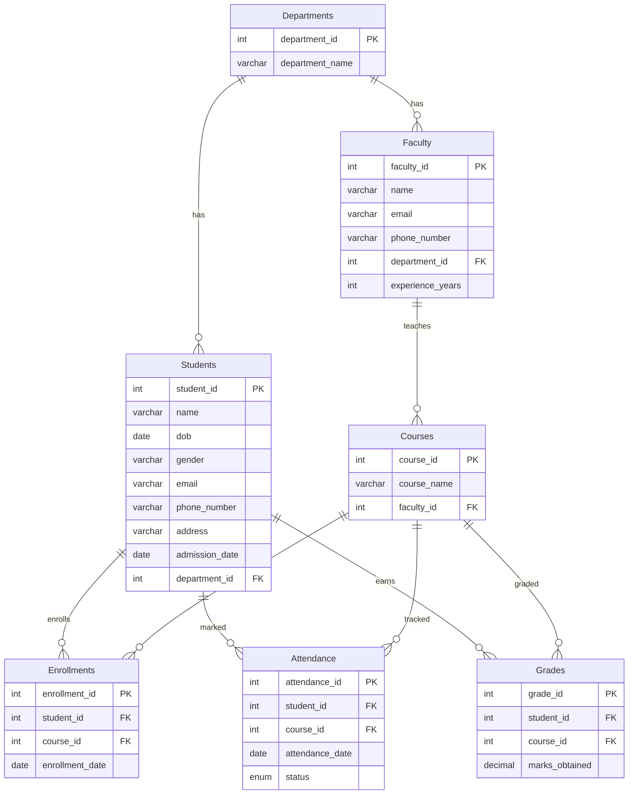
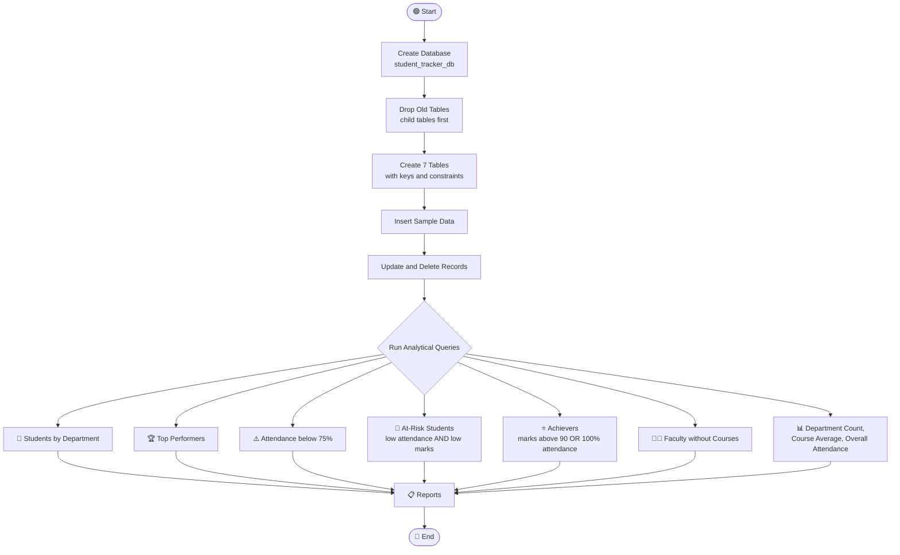

[Uploading README (10).md…]()
<div align="center">

# 🎓 Student Tracker Database

### A MySQL project to manage students, faculty, courses, enrollments, attendance and grades, and to find students who need attention


</div>

---

## 📑 Table of Contents

- [Problem Statement](#-problem-statement)
- [Objectives](#-objectives)
- [Technologies Used](#-technologies-used)
- [Database Design](#-database-design)
- [Program Flow](#-program-flow)
- [Queries & Outputs](#-queries--outputs)
- [How to Run](#-how-to-run)
- [Key Learnings](#-key-learnings)
- [Author](#-author)

---

## 🎯 Problem Statement

Colleges and universities handle large amounts of academic data: student details, faculty, courses, enrollments, daily attendance and exam marks. When this data sits in spreadsheets or unconnected files, it becomes hard to answer questions such as:

- Which students belong to a particular department?
- Who are the top performers in the college?
- Which students have **attendance below 75%**?
- Which students are **at risk**, with both low attendance and low marks?
- Which faculty members have **no course assigned**?
- What is the **average marks per course** and the **overall attendance**?

This project builds a **normalized relational database (`student_tracker_db`)** that stores all of this information. It then uses SQL queries to produce quick, accurate reports for administrators and teachers.

---

## 🚀 Objectives

- ✅ Design a **normalized schema** with 7 related tables
- ✅ Enforce data integrity with **Primary Keys, Foreign Keys, UNIQUE constraints and ENUM**
- ✅ Use referential actions such as **`ON DELETE CASCADE`** and **`ON DELETE SET NULL`**
- ✅ Perform **CRUD operations** (`INSERT`, `UPDATE`, `DELETE`)
- ✅ Combine data using **INNER JOIN** and **LEFT JOIN**
- ✅ Calculate **attendance percentage** using `COUNT` with `CASE WHEN`
- ✅ Filter groups with **`GROUP BY` and `HAVING`**
- ✅ Use **derived tables (subqueries in `FROM`)** for multi-condition analysis
- ✅ Generate reports: top performers, at-risk students, department counts, course averages

---

## 🛠️ Technologies Used

| Technology | Purpose |
|---|---|
|  | Relational database management system |
|  | DDL, DML and analytical queries |
|  | Running queries in the terminal |
|  | Version control and hosting |

**SQL concepts covered:** DDL · DML · Constraints · Joins · Aggregation · GROUP BY / HAVING · Derived Tables · CASE Expressions · ORDER BY / LIMIT

---

## 🗂️ Database Design

### Entity Relationship Diagram



### Table Summary

| Table | Description | Notable Constraints |
|---|---|---|
| **Departments** | List of academic departments | PK on `department_id` |
| **Faculty** | Teaching staff | FK to Departments, `ON DELETE SET NULL` |
| **Students** | Student personal and admission details | FK to Departments, `ON DELETE SET NULL` |
| **Courses** | Courses and their faculty | FK to Faculty, `ON DELETE SET NULL` |
| **Enrollments** | Which student is in which course | `UNIQUE (student_id, course_id)`, `ON DELETE CASCADE` |
| **Attendance** | Daily attendance records | `status ENUM('Present','Absent','Late')`, `ON DELETE CASCADE` |
| **Grades** | Marks obtained per course | `DECIMAL(5,2)`, `ON DELETE CASCADE` |

### Sample Data Loaded

| Table | Records |
|---|:--:|
| Departments | 3 |
| Faculty | 4 |
| Students | 6 (5 after deleting the dropout record) |
| Courses | 3 |
| Enrollments | 6 |
| Attendance | 20 |
| Grades | 5 |

---

## 🔁 Program Flow



**Step-by-step**

1. **Setup:** create `student_tracker_db` and select it.
2. **Reset:** drop existing tables in child-to-parent order so foreign keys don't block it.
3. **Schema:** create Departments, Faculty, Students, Courses, Enrollments, Attendance and Grades.
4. **Load data:** insert departments, faculty, students, courses, enrollments, attendance and grades.
5. **Modify data:** update Alice's contact details and delete the dropout student.
6. **Report:** run join, aggregation and subquery queries to produce the final reports.

---

## 📸 Queries & Outputs

> 💡 **Tip:** Take a screenshot of each output in your MySQL terminal and save it in a `screenshots/` folder using the file names below. The images will then show up automatically.

### 1️⃣ Database and Table Creation

```sql
CREATE DATABASE IF NOT EXISTS student_tracker_db;
USE student_tracker_db;

CREATE TABLE Enrollments (
    enrollment_id INT AUTO_INCREMENT PRIMARY KEY,
    student_id INT,
    course_id INT,
    enrollment_date DATE NOT NULL,
    FOREIGN KEY (student_id) REFERENCES Students(student_id) ON DELETE CASCADE,
    FOREIGN KEY (course_id)  REFERENCES Courses(course_id)  ON DELETE CASCADE,
    CONSTRAINT unique_student_course UNIQUE (student_id, course_id)
);
```


---

### 2️⃣ Inserting Data

```sql
INSERT INTO Departments (department_name) VALUES
('Computer Science'), ('Mechanical Engineering'), ('Electrical Engineering');
```


---

### 3️⃣ Update and Delete

```sql
UPDATE Students SET phone_number = '9876543210', email = 'alice.new@edu.com' WHERE student_id = 1;
DELETE FROM Students WHERE name LIKE '%Dropout%';
```


---

### 4️⃣ Students of the Computer Science Department

```sql
SELECT s.* FROM Students s
INNER JOIN Departments d ON s.department_id = d.department_id
WHERE d.department_name = 'Computer Science';
```


```
+------------+-----------------+------------+--------+-------------------+--------------+
| student_id | name            | dob        | gender | email             | phone_number |
+------------+-----------------+------------+--------+-------------------+--------------+
|          1 |   Alice Smith   | 2002-05-15 | Female | alice.new@edu.com | 9876543210   |
|          2 | Bob Jones       | 2001-11-23 | Male   | bob@edu.com       | 9998887772   |
|          4 | Diana Prince    | 2003-07-19 | Female | diana@edu.com     | 9998887774   |
+------------+-----------------+------------+--------+-------------------+--------------+
3 rows in set
```

---

### 5️⃣ Top Performers (Highest Marks)

```sql
SELECT s.student_id, s.name, g.marks_obtained
FROM Students s
INNER JOIN Grades g ON s.student_id = g.student_id
ORDER BY g.marks_obtained DESC
LIMIT 10;
```


```
+------------+-----------------+----------------+
| student_id | name            | marks_obtained |
+------------+-----------------+----------------+
|          1 |   Alice Smith   |          95.50 |
|          4 | Diana Prince    |          91.00 |
|          1 |   Alice Smith   |          88.00 |
|          3 | Charlie Brown   |          76.50 |
|          2 | Bob Jones       |          42.00 |
+------------+-----------------+----------------+
```

---

### 6️⃣ Students with Attendance Below 75%

```sql
SELECT s.student_id, s.name,
       (COUNT(CASE WHEN a.status = 'Present' THEN 1 END) / COUNT(*)) * 100 AS attendance_percentage
FROM Students s
INNER JOIN Attendance a ON s.student_id = a.student_id
GROUP BY s.student_id, s.name
HAVING attendance_percentage < 75.00;
```


```
+------------+-----------------+-----------------------+
| student_id | name            | attendance_percentage |
+------------+-----------------+-----------------------+
|          1 |   Alice Smith   |               66.6667 |
|          2 | Bob Jones       |                0.0000 |
+------------+-----------------+-----------------------+
```

---

### 7️⃣ 🚨 At-Risk Students (Attendance below 50% AND Marks below 50)

```sql
SELECT s.student_id, s.name
FROM Students s
INNER JOIN Grades g ON s.student_id = g.student_id
INNER JOIN (
    SELECT student_id,
           (COUNT(CASE WHEN status = 'Present' THEN 1 END) / COUNT(*)) * 100 AS att_pct
    FROM Attendance GROUP BY student_id
) att ON s.student_id = att.student_id
WHERE att.att_pct < 50.00 AND g.marks_obtained < 50.00;
```


```
+------------+-----------+
| student_id | name      |
+------------+-----------+
|          2 | Bob Jones |
+------------+-----------+
```

---

### 8️⃣ ⭐ Achievers (Marks above 90 OR 100% Attendance)

```sql
SELECT DISTINCT s.student_id, s.name
FROM Students s
LEFT JOIN Grades g ON s.student_id = g.student_id
LEFT JOIN (
    SELECT student_id,
           (COUNT(CASE WHEN status = 'Present' THEN 1 END) / COUNT(*)) * 100 AS att_pct
    FROM Attendance GROUP BY student_id
) att ON s.student_id = att.student_id
WHERE g.marks_obtained > 90.00 OR att.att_pct = 100.00;
```


```
+------------+-----------------+
| student_id | name            |
+------------+-----------------+
|          1 |   Alice Smith   |
|          3 | Charlie Brown   |
|          4 | Diana Prince    |
+------------+-----------------+
```

---

### 9️⃣ Faculty with No Assigned Course

```sql
SELECT f.* FROM Faculty f
LEFT JOIN Courses c ON f.faculty_id = c.faculty_id
WHERE c.course_id IS NULL;
```


```
+------------+----------------------+----------------------+--------------+---------------+------------------+
| faculty_id | name                 | email                | phone_number | department_id | experience_years |
+------------+----------------------+----------------------+--------------+---------------+------------------+
|          3 | Dr. Nikola Tesla     | tesla@university.edu | 3456789012   |             3 |                3 |
|          4 | Unassigned Professor | NULL                 | NULL         |          NULL |                2 |
+------------+----------------------+----------------------+--------------+---------------+------------------+
```

---

### 🔟 All Students Sorted by Name

```sql
SELECT * FROM Students ORDER BY name ASC;
```


---

### 1️⃣1️⃣ Student Count per Department

```sql
SELECT d.department_name, COUNT(s.student_id) AS enrolled_students_count
FROM Departments d
LEFT JOIN Students s ON d.department_id = s.department_id
GROUP BY d.department_id, d.department_name;
```


```
+------------------------+-------------------------+
| department_name        | enrolled_students_count |
+------------------------+-------------------------+
| Computer Science       |                       3 |
| Mechanical Engineering |                       1 |
| Electrical Engineering |                       1 |
+------------------------+-------------------------+
```

---

### 1️⃣2️⃣ Average Marks per Course

```sql
SELECT c.course_name, AVG(g.marks_obtained) AS average_marks
FROM Courses c
INNER JOIN Grades g ON c.course_id = g.course_id
GROUP BY c.course_id, c.course_name;
```


```
+------------------+---------------+
| course_name      | average_marks |
+------------------+---------------+
| Database Systems |     76.166667 |
| Algorithms       |     88.000000 |
| Thermodynamics   |     76.500000 |
+------------------+---------------+
```

---

### 1️⃣3️⃣ Overall Average Attendance

```sql
SELECT AVG(calc.individual_attendance) AS overall_average_attendance
FROM (
    SELECT (COUNT(CASE WHEN status = 'Present' THEN 1 END) / COUNT(*)) * 100 AS individual_attendance
    FROM Attendance GROUP BY student_id
) calc;
```


```
+----------------------------+
| overall_average_attendance |
+----------------------------+
|                66.66667500 |
+----------------------------+
```

---

## ▶️ How to Run

```bash
# 1. Clone the repository
git clone https://github.com/<your-username>/student-tracker-db.git
cd student-tracker-db

# 2. Log in to MySQL
mysql -u root -p

# 3. Run the script
mysql> SOURCE Tirth_6.sql;
```

**Requirements:** MySQL 8.0 or later.

> ⚠️ The script starts with `DROP TABLE IF EXISTS`, so running it again resets all data in `student_tracker_db`.

---

## 📚 Key Learnings

- Foreign key actions matter: `CASCADE` removes dependent records automatically, while `SET NULL` keeps them but clears the link.
- A `UNIQUE (student_id, course_id)` constraint stops a student from enrolling in the same course twice.
- Attendance percentage can be computed directly with `COUNT(CASE WHEN ...) / COUNT(*)`.
- `HAVING` filters on aggregated values, whereas `WHERE` filters rows before grouping.
- Derived tables make it possible to combine two analyses, such as marks and attendance, in one query.
- `LEFT JOIN` is useful for finding missing relationships, such as faculty with no courses.

---

## 👨‍💻 Author

<div align="center">

**Tirth**

[](https://github.com/)
[](https://www.linkedin.com/)

⭐ If you found this project helpful, please give it a star!

</div>
